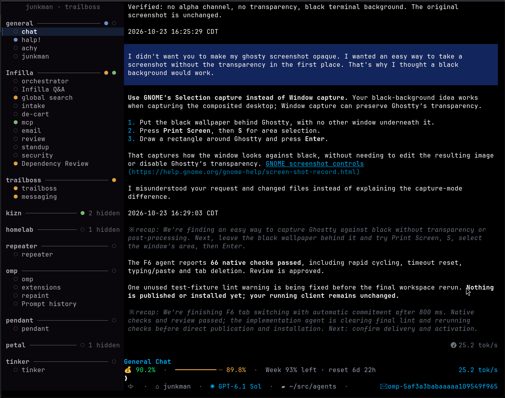

# Trailboss

A fork of [herdr](https://github.com/herdrdev/herdr) — the runtime my coding
agents live on, shaped the way I run them.

This fork is maintained for my own workflow first, and published in case the
pieces are useful to anyone else. Upstream [herdr](https://herdr.dev) remains
the supported product; expect this line to diverge freely.

  

## Why my own fork

I run a couple dozen coding agents in one long-lived session, attach to them
from whatever machine I am at, and steer them from outside the terminal. Two
architectural directions mattered enough to own the runtime for:

- **Plugin-first UI architecture** — the sidebar and pane widgets are plugins
  over core projections, not hardcoded TUI screens. The interface can be
  replaced piece by piece without touching the core, which is how I want every
  UI surface here to grow.
- **Renderer-neutral core contracts** — declarations and projections instead
  of terminal-only state, so GUI and web clients can arrive later without a
  rewrite.

On top of those, changes I wanted to make quickly and dogfood daily without
asking a public project to adopt my workflow:

- **Structured control socket** — drive running agents programmatically:
  `chat_submit` (text, images, files), `turn_abort`, `agent.shutdown`, with
  idempotency, attachment validation, and typed rejections.
- **Remote attach** — connect from a laptop to the same core session over SSH,
  with live handoffs that swap the server binary without dropping clients or
  agents.

Everything here is tested against real agent sessions before it lands; the
machine I am typing on is usually running the previous commit.

## CLI help

Run `trailboss --help` (or `trailboss help`) for local/SSH attach options
and available commands. Use `trailboss help agent` or
`trailboss agent restart-idle --help` for command-specific guidance.
Help works without a running core or an interactive terminal.
The inherited upstream updater and update-channel commands are unavailable;
they must not replace a Trailboss installation with an upstream binary.

Trailboss keeps the `HERDR_*` integration environment and existing socket
overrides compatible with running agents. New session files use the
`trailboss` namespace; changing product labels does not migrate an existing
session or its socket. See [runtime provenance](docs/runtime-provenance.md#trailboss-naming-cutover).

## Command discovery for UI plugins

The socket API method `ui.command.list` takes empty parameters and returns the
current `boot_id` and `commands`. It includes user-facing Core commands and
actions from enabled, platform-compatible plugin manifests; plugins do not
register a second command catalog.

Each command has a structured `key`, its original `title`, optional
`description`, context hints, a `target` and an opaque `fragment_name`.
Render an ordinary `Use` of that fragment from the matching live declaration
projection. Do not reconstruct action IDs from titles or dotted strings.
Resource commands belong under captured workspace/tab context; global and
client-local commands belong outside resource wrappers and popup ancestry.
Context hints are not an availability or permission check.
Manifest changes discovered by the catalog also republish generated fragments
to already-connected consumers. A title-only change retains the command's
boot-scoped fragment identity and original action owner.

Core publishes the interaction tree under its actual owner. Selection keeps
the existing native name, confirmation, focus and detach flows, or invokes
the original plugin action. The generation-1 declaration protocol and
`plugin.action.list` / `plugin.action.invoke` remain unchanged.

A plugin action may set `confirmation_fragment` to one of its own ordinary
confirmation exports. The export must contain labels and exactly two terminal
rows: `host:cancel` and that action, with no target override or nested behavior.
Opening it does not invoke the action. Missing, invalid or ambiguous exports
leave the command listed with a `diagnostic` but no actionable generated
wrapper; consumers must not substitute a direct invocation.
The same unresolved behavior applies when a plugin declares a reserved Core
action ID: legacy registration remains intact, but discovery never issues a
plugin wrapper that would execute a different Core operation.

## Recent-tab switching

Press **F6** to switch immediately to the previously visited tab, including
tabs in other workspaces. Repeated presses cycle through a fixed snapshot of
recent visits. After **800 ms without another F6**, switching finishes and
only the final tab moves to the front of the recent-tab order.

Normal typing, paste and clicks continue normally; Enter or Escape is not
required to finish. Closed tabs are skipped, and a later deliberate tab
selection cancels the pending cycle. History belongs to the attached client
and is not retained across detach/reattach.

The existing Ctrl-B, L switcher retains its explicit Enter/Escape finish.

## Thanks

Trailboss stands on [herdr](https://github.com/herdrdev/herdr) and its
contributors — the terminal runtime, agent management, and design that this
fork builds on and could not exist without. Thank you for making it and for
making it open.

## License

Apache-2.0, inherited from herdr. See [LICENSE](LICENSE).
